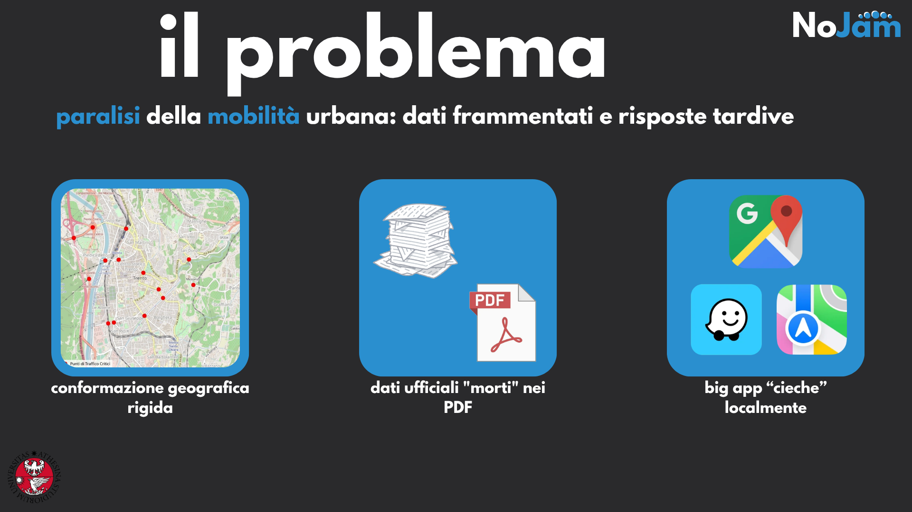
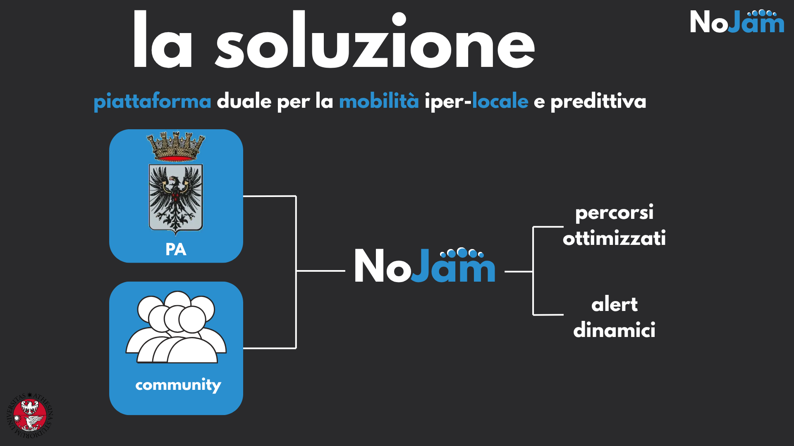
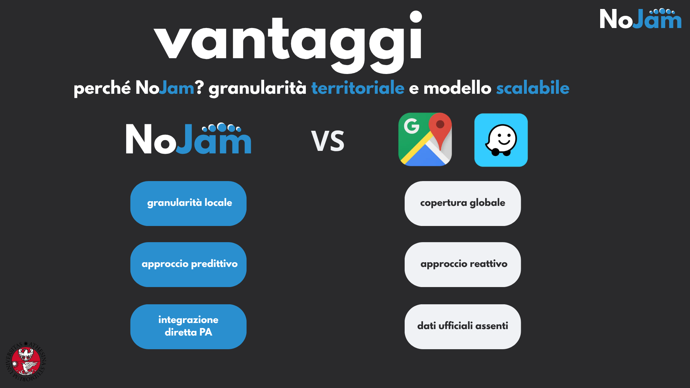

# Il progetto NoJam

<!-- TODO: inline the 3 pictures -->

A Trento il traffico è un problema sistemico: la nostra città si sviluppa su assi viari obbligati. Quando partono i cantieri estivi o nevica, la città si ferma. Le informazioni ufficiali esistono, il Comune e la Provincia pubblicano dettagliate ordinanze in PDF e tabelle di marcia, ma rimangono isolate su siti burocratici. I grandi navigatori ignorano la programmazione locale. Il risultato è ore perse nel traffico, aumento delle emissioni e un’amministrazione che fatica a gestire la viabilità.

La nostra soluzione è NoJam, una piattaforma basata su un'architettura duale. Da un lato colleziona dalla Pubblica Amministrazione tutti i dati ufficiali e statici: tabelle dello sgombero neve, cantieri e deviazioni programmate. Dall'altro raccoglie dagli utenti le informazioni dinamiche in tempo reale, come rallentamenti ed incidenti. Il cuore del sistema è un algoritmo che incrocia queste fonti per valutare l'affidabilità delle segnalazioni, calcolare i percorsi migliori e inviare alert preventivi. 
A differenza delle grandi app globali, NoJam agisce con granularità iper-locale sui dati certi del territorio, con benefici immediati e tangibili. Per i cittadini significa viaggiare senza stress, ricevendo alert preventivi e percorsi basati su dati verificati. Per la Pubblica Amministrazione rappresenta uno strumento di Smart Governance, fornendo un canale diretto per orchestrare la mobilità e valorizzare il proprio lavoro sul territorio. 
L'architettura di NoJam nasce sul territorio di Trento, ma è nativamente scalabile a qualsiasi altra realtà comunale o provinciale.

Ci si potrebbe chiedere: perché un utente dovrebbe scegliere NoJam rispetto a Google Maps o Waze?
Le grandi piattaforme globali lavorano su macro-dati e sulla reattività aggregata. NoJam vince sulla granularità: dialoga direttamente con gli enti territoriali e conosce la mappa dei lavori o della neve prima che abbiano un impatto sulla strada.
Trento rappresenta il nostro campo di prova e il laboratorio ideale per densità e conformazione viaria. Tuttavia, l'architettura software di NoJam è strutturata in modo modulare: la logica di ingestion delle ordinanze e il motore predittivo sono nativamente pronti per essere scalati e adottati da qualsiasi altro Comune o Provincia.

<!--
TODO: add this things

### Vantaggi per il comune
- [Vantaggio 1: es. ottimizzazione dei processi, riduzione dei costi, migliore gestione delle risorse]
- [Vantaggio 2]
- [Vantaggio 3]

### Vantaggi per i cittadini
- [Vantaggio 1: es. accesso remoto, autonomia, trasparenza]
- [Vantaggio 2]
- [Vantaggio 3]

### Limiti dell'applicazione
- [Limite 1: es. dipendenza dalla connessione internet, accessibilità digitale]
- [Limite 2]
- [Limite 3]
-->
