# Design Front-end

<!--
In questo capitolo vengono presentati i mockup delle principali schermate dell’applicazione, che rappresentano il comportamento e l’esperienza utente attesa, senza specificare dettagli tecnici di implementazione. Ogni mockup significativo indica i requisiti, le User Story e/o gli Use Case a cui contribuisce.
-->

<!--
### MU-Fig.1: [nome schermata]

[Descrizione del mockup e del comportamento rappresentato.]

**Collegamenti principali:** RF-000, RF-010; UC-000, UC-010; US-000, US-010.

Il mockup rappresenta il comportamento e l’esperienza utente attesa e non dimostra, da solo, il soddisfacimento di requisiti non funzionali come compatibilità o affidabilità.
-->

I mockup sono riportati come screenshot di pagine statiche HTML/CSS e illustrano il comportamento e l’esperienza utente attesa. Non dimostrano, da soli, il soddisfacimento di requisiti non funzionali come compatibilità o affidabilità.

### MU-Fig.1: Mappa per utente anonimo
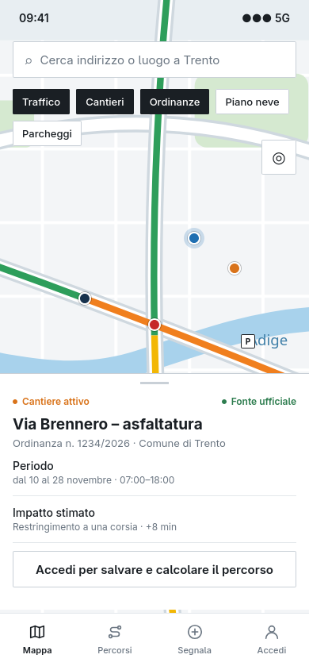{width=40%}

Schermata della mappa consultabile senza autenticazione, con livelli di traffico, cantieri e ordinanze attivi. La selezione di un cantiere apre una scheda di dettaglio con periodo, impatto stimato e fonte ufficiale. Le funzioni riservate (salvataggio, calcolo del percorso, segnalazioni) sono presentate con l’invito ad accedere.

**Collegamenti principali:** RF-006, RF-017; UC-006, UC-017; US-002.

### MU-Fig.2: Registrazione
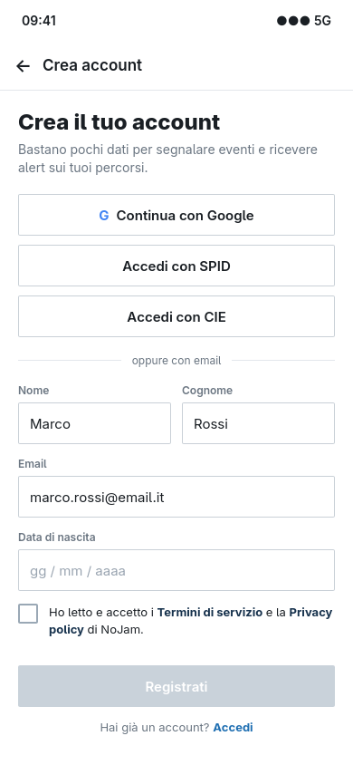{width=40%}

Creazione dell’account tramite inserimento dei dati personali oppure tramite provider esterno (Google, SPID/CIE). Il pulsante di registrazione resta disabilitato finché l’utente non accetta i Termini di servizio e la Privacy policy.

**Collegamenti principali:** RF-001, RF-037, RF-049; UC-001, UC-037, UC-049; US-001, US-004.

### MU-Fig.3: Accesso
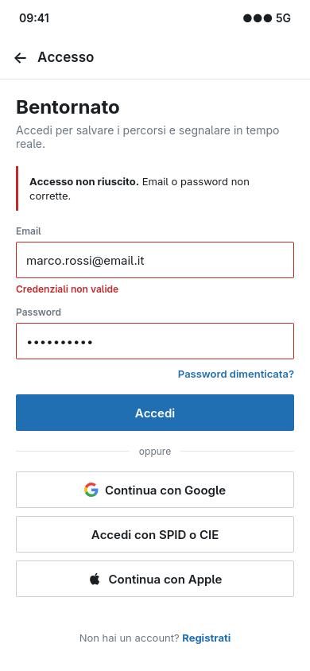{width=40%}

Autenticazione con credenziali o provider esterno. In caso di credenziali errate o autenticazione rifiutata, il sistema mostra un messaggio di errore e non apre la sessione.

**Collegamenti principali:** RF-002, RF-049; UC-002, UC-049; US-001.

### MU-Fig.4: Consensi cookie e privacy
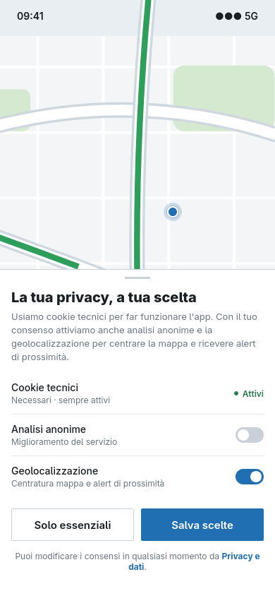{width=40%}

Banner di primo accesso con scelta granulare dei consensi: cookie tecnici sempre attivi, analisi anonime e geolocalizzazione, con possibilità di accettare solo i trattamenti essenziali.

**Collegamenti principali:** RF-008, RF-038; UC-008, UC-038; US-004.

### MU-Fig.5: Segnalazione di un evento in tempo reale
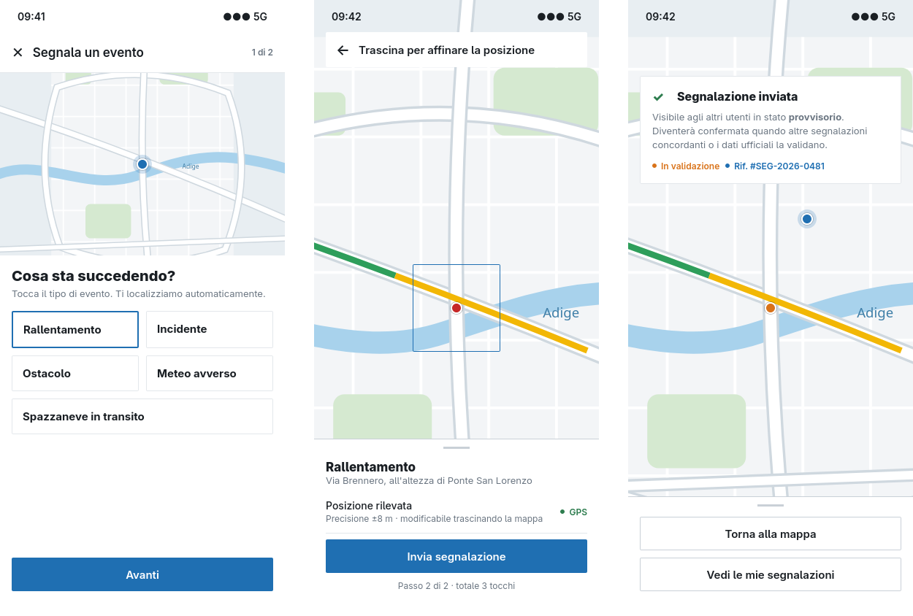{width=90%}

Flusso di segnalazione in tre schermate: scelta del tipo di evento, conferma della posizione rilevata automaticamente con possibilità di affinarla sulla mappa, esito con stato provvisorio e riferimento della segnalazione. Il flusso richiede tre tocchi complessivi.

**Collegamenti principali:** RF-009, RF-014; UC-009, UC-014; US-009; RNF-006.

### MU-Fig.6: Pianificazione e anteprima del percorso
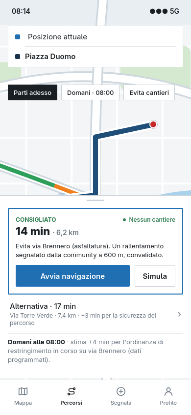{width=40%}

Inserimento di partenza e destinazione, con possibilità di scegliere un orario futuro. Il percorso consigliato indica tempi, distanza e criticità ufficiali evitate; sono proposte alternative e una stima per la fascia oraria scelta, con possibilità di simulare il viaggio prima di avviare la navigazione.

**Collegamenti principali:** RF-016, RF-028, RF-030, RF-031; UC-016, UC-028, UC-030, UC-031; US-006, US-007.

### MU-Fig.7: Navigazione turn-by-turn ad alto contrasto
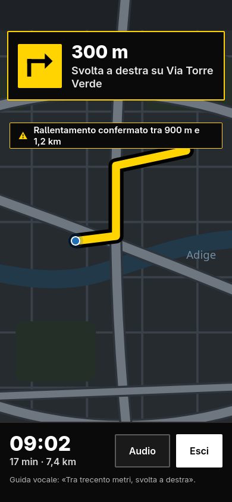{width=40%}

Durante la guida la schermata mostra una sola istruzione in primo piano, la distanza alla manovra, l’orario di arrivo e gli avvisi di criticità confermate. Il contrasto è elevato e le indicazioni sono sintetiche per ridurre le distrazioni.

**Collegamenti principali:** RF-032; UC-032; US-007; RNF-006.

### MU-Fig.8: Livelli della mappa: piano neve e mobilità
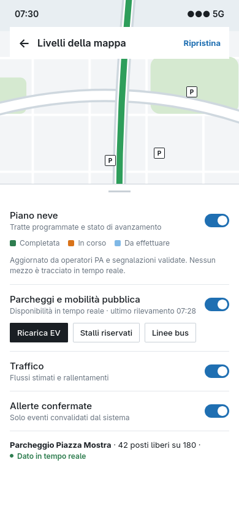{width=40%}

Pannello di selezione dei livelli: piano neve con legenda dello stato delle tratte (completata, in corso, da effettuare), parcheggi e trasporto pubblico con filtri per ricarica EV e stalli riservati, traffico e allerte confermate. Il pannello indica la data dell’ultimo rilevamento.

**Collegamenti principali:** RF-017, RF-018, RF-024; UC-017, UC-018, UC-024; US-014, US-022.

### MU-Fig.9: Profilo, reputazione e segnalazioni
{width=40%}

Profilo dell’utente con punteggio di reputazione, livello, badge sbloccati e bloccati, e storico delle segnalazioni con stato di validazione (confermata, in validazione, decaduta, smentita) e variazione del punteggio.

**Collegamenti principali:** RF-003, RF-011, RF-025; UC-003, UC-011, UC-025; US-010.

### MU-Fig.10: Notifiche e preferenze
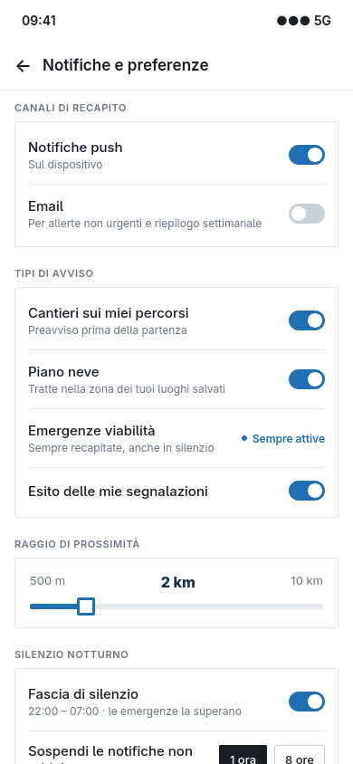{width=40%}

Configurazione dei canali di recapito, dei tipi di avviso, del raggio di prossimità e delle fasce di silenzio. Le emergenze risultano sempre attive. La lingua è selezionabile tra italiano, inglese e tedesco.

**Collegamenti principali:** RF-004, RF-010, RF-040, RF-041, RF-042; UC-004, UC-010, UC-040, UC-041, UC-042; US-011, US-020.

### MU-Fig.11: Privacy e gestione account
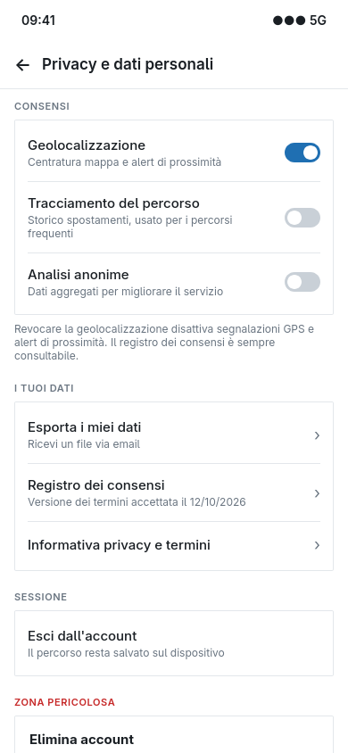{width=40%}

Gestione dei consensi (geolocalizzazione, tracciamento del percorso, analisi anonime), esportazione dei dati, registro dei consensi, disconnessione e richiesta di eliminazione dell’account con l’avviso sulla sorte delle segnalazioni.

**Collegamenti principali:** RF-007, RF-008, RF-029; UC-007, UC-008, UC-029; US-003.

### MU-Fig.12: Dashboard Smart Governance
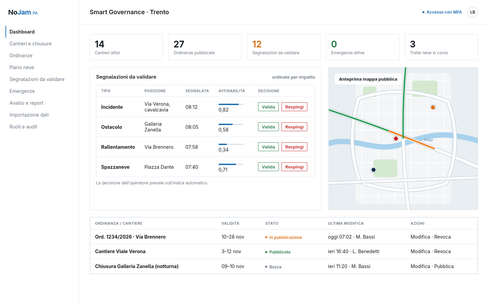{width=90%}

Dashboard dell’Operatore PA con indicatori di sintesi, coda delle segnalazioni da validare ordinate per impatto (con indice di affidabilità e decisione dell’operatore, che prevale su quella automatica), anteprima della mappa pubblica e stato delle ordinanze e dei cantieri (bozza, pubblicato, in pubblicazione).

**Collegamenti principali:** RF-019, RF-022, RF-043, RF-045; UC-019, UC-022, UC-043, UC-045; US-013.

### MU-Fig.13: Attivazione Emergenza Viabilità
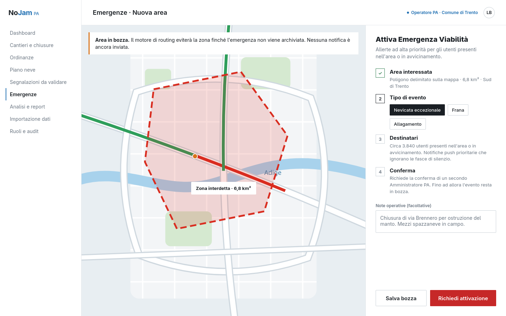{width=90%}

L’Operatore PA delimita l’area interessata sulla mappa, sceglie il tipo di evento e verifica i destinatari stimati. L’attivazione richiede la conferma di un secondo Amministratore PA; fino ad allora l’evento resta in bozza e non viene propagato.

**Collegamenti principali:** RF-027; UC-027; US-015.

### MU-Fig.14: Importazione massiva dei dati
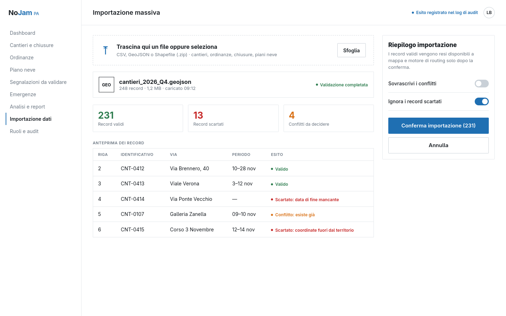{width=90%}

Caricamento di un file CSV, GeoJSON o Shapefile con anteprima dei record validi, scartati e in conflitto prima della conferma. Il riepilogo indica che i dati diventano disponibili alla mappa e al motore di routing solo dopo la conferma.

**Collegamenti principali:** RF-036; UC-036; US-018.
